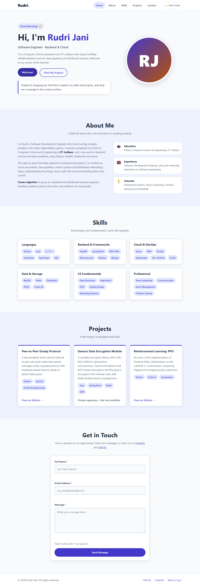
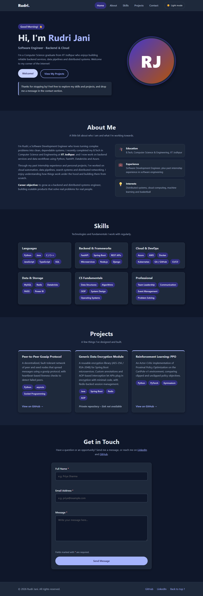
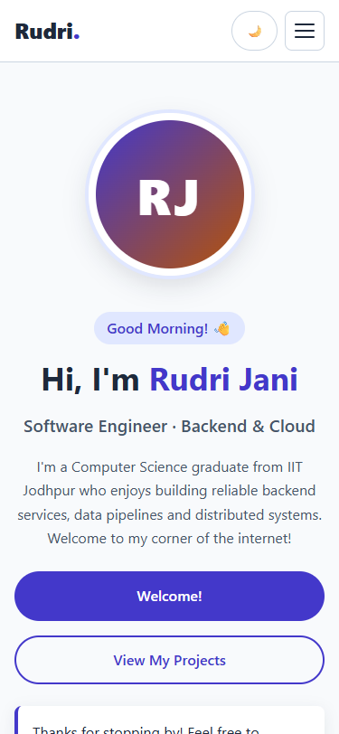
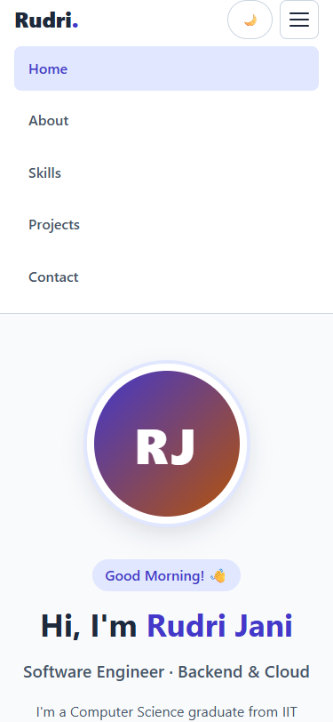
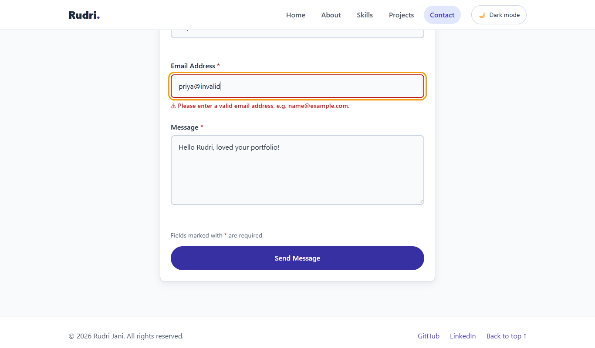
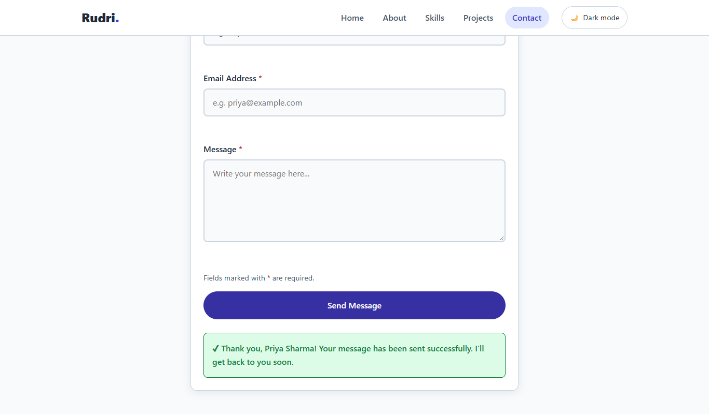

# Personal Portfolio Website

A responsive personal portfolio for **Rudri Jani**, Software Engineer and CSE graduate from IIT Jodhpur.
It is built with plain **HTML5, CSS3 and Vanilla JavaScript**, with no frameworks or libraries.

## Features

| Area | What it does |
|------|--------------|
| **Home** | Name, short intro, a time-based greeting (Good Morning / Afternoon / Evening), a **Welcome** button that shows a welcome message, and a "View My Projects" call-to-action |
| **About** | Short introduction, education, experience summary, interests and career objective |
| **Skills** | 6 skill groups shown as cards with badges |
| **Projects** | 3 project cards, each with a description, technologies used and a GitHub link (or a labelled placeholder for the private repo) |
| **Contact** | Form with Full Name, Email and Message, validated in the browser, with error and success messages |
| **Footer** | Name, copyright (auto-updated year) and profile links |
| **Theme toggle** | Switches between light and dark themes. The choice is saved in `localStorage`, and the first visit follows the OS setting |
| **Navigation** | Sticky header, smooth scrolling, the link for the current section is highlighted, and a hamburger menu on mobile |

### Contact form validation
- Empty fields and **whitespace-only** input are rejected (values are trimmed first).
- The email address must have a valid format (`name@domain.tld`).
- Name must be at least 2 characters and the message at least 10.
- All errors show at once, and focus moves to the first invalid field.
- Errors use an icon, text and a red border, so they don't rely on colour alone.
- An error clears as soon as the visitor fixes that field.
- On valid input, the default submit is prevented and the button is disabled while "Sending...", so **repeated clicks** do nothing. Then a success message appears and the form resets. There is no backend.

### Responsive & accessible
- CSS Grid and Flexbox layouts with breakpoints at **900px** (tablet), **768px** (hamburger nav) and **560px** (mobile).
- Tested at 1366px, 820px, 375px and 320px widths with no horizontal scrolling.
- Semantic elements (`header`, `nav`, `main`, `section`, `article`, `footer`), labels linked to their inputs, `aria-live` status messages and a skip link.
- Keyboard friendly: a visible focus ring on every interactive element, and Escape closes the mobile menu.
- Touch targets are at least 44px high, and `prefers-reduced-motion` is respected.

## Technologies Used
- HTML5
- CSS3 (custom properties, Flexbox, Grid, media queries)
- Vanilla JavaScript (ES6+: `const`/`let`, arrow functions, template literals, `IntersectionObserver`)

## Project Structure
```
personal-portfolio/
├── index.html
├── css/
│   └── style.css
├── js/
│   └── script.js
├── assets/
│   └── screenshots/    # README screenshots
├── README.md
└── ai-usage.md
```

## Run Locally
No build step or install is needed.

1. Clone the repository:
   ```bash
   git clone https://github.com/rudri1202/personal-portfolio.git
   cd personal-portfolio
   ```
2. Open `index.html` in any modern browser (double-click it), **or** serve it locally, for example with the VS Code **Live Server** extension or:
   ```bash
   python -m http.server 8000
   # then visit http://localhost:8000
   ```

## Screenshots

| Light theme | Dark theme |
|-------------|------------|
|  |  |

| Mobile | Mobile menu |
|--------|-------------|
|  |  |

| Validation errors | Success message |
|-------------------|-----------------|
|  |  |

## Known Limitations
- The contact form has no backend, so messages are not actually sent. Submission is simulated on the page.
- The email check uses a simple pattern. It catches common mistakes but is not a full RFC 5322 validator.
- The "Generic Data Encryption Module" project is in a private repository, so it shows a labelled placeholder instead of a link.
- The greeting uses the visitor's device clock and is set when the page loads.
